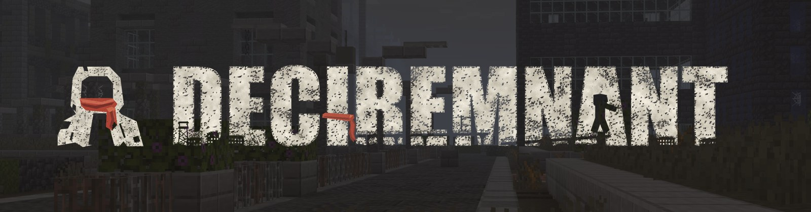
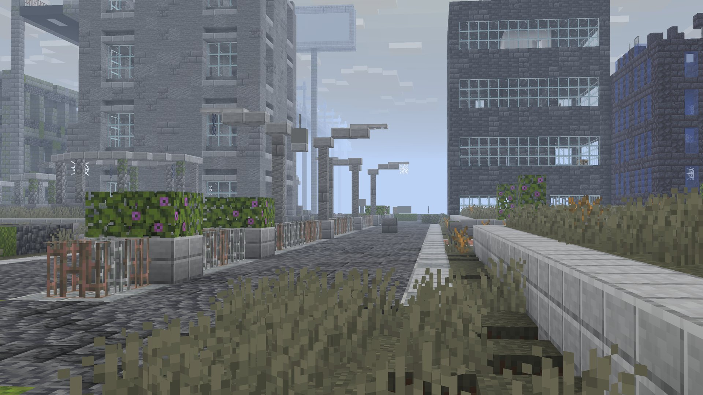
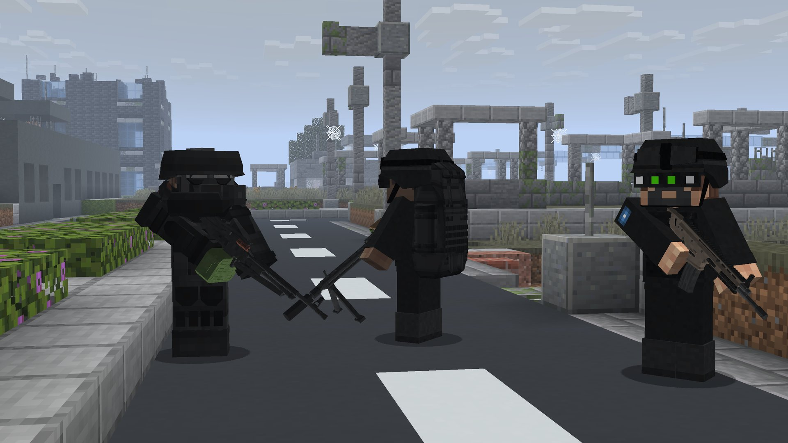
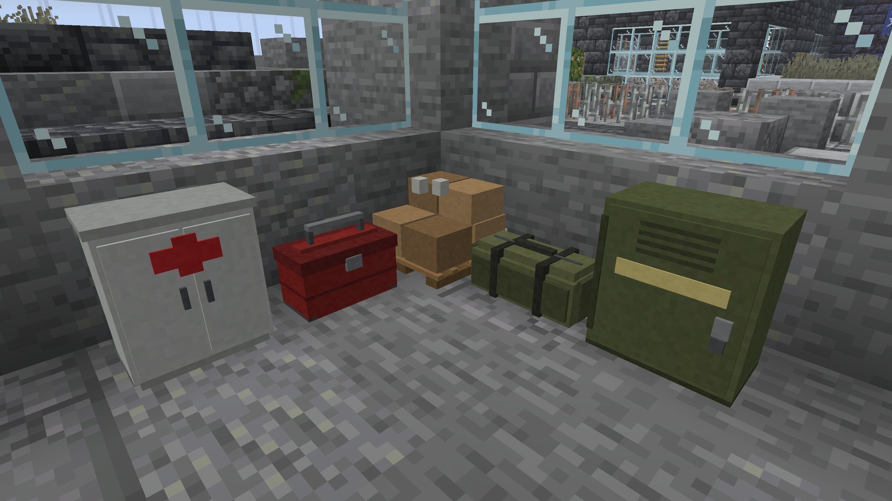
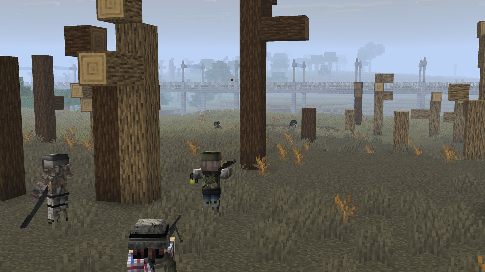
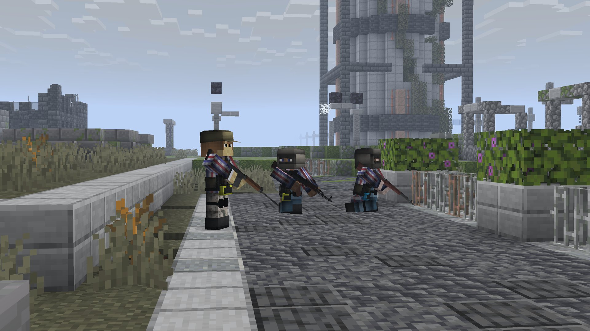
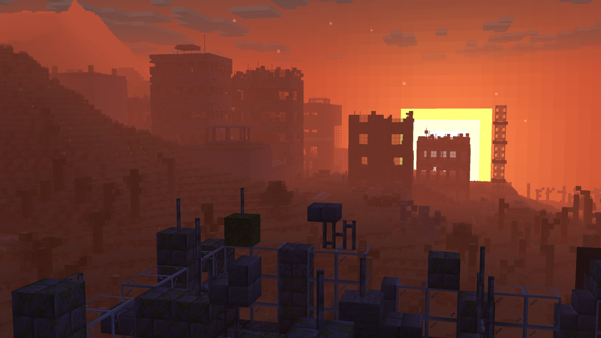

# DeciRemnant Aftermath

An unofficial rewrite of the Decimation zombie survival mod for **Minecraft Java 1.21.11** (Fabric).

Explore ruined Lost Cities streets, search furnished apartments for supplies, trade with survivors, fight infected and armed factions, and host a world for your friends.

**Website:** https://deciremnant.my.id · **Download:** https://deciremnant.my.id/download · **Discord:** https://discord.gg/ZJ47zfXn8H

## Screenshots

| | |
|---|---|
|  |  |
|  |  |
|  |  |

## Features

- Ruined cities built by Lost Cities, dressed with Decimation props, loot and decay
- Decimation's guns, attachments, armor, gear and survival stats (thirst, blood, infection, radiation)
- Infected, bandits, Soviets, friendly soldiers, traders and survivor partners
- Safezones, military zones and supply drops
- Host your world online for friends: relay, direct IPv6 or playit.gg

## Install

1. Minecraft Java 1.21.11 with Java 21 or newer, Fabric Loader 0.18.0 or newer and Fabric API.
2. Download `DeciRemnant-Fabric.jar` from the website and put it in your `mods/` folder.
3. Start a new world.

## Status

Alpha: 1.0 is the first alpha, each 1.x update brings fixes and new content; 2.0 will be the beta, then stable. Report bugs on Discord with your version and what happened.

## Licence

All rights reserved. This repository holds no source code; it is a project page. The mod's code is not open source.

Decimation was created by BoehMod. DeciRemnant is an unofficial fan project and is not affiliated with BoehMod or Mojang. Third-party models and libraries keep their own licences (see the release notes and the notices inside the jar).
